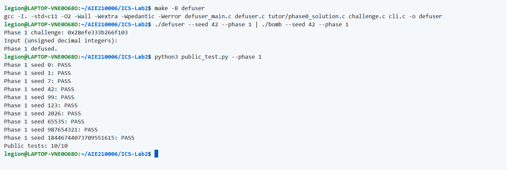
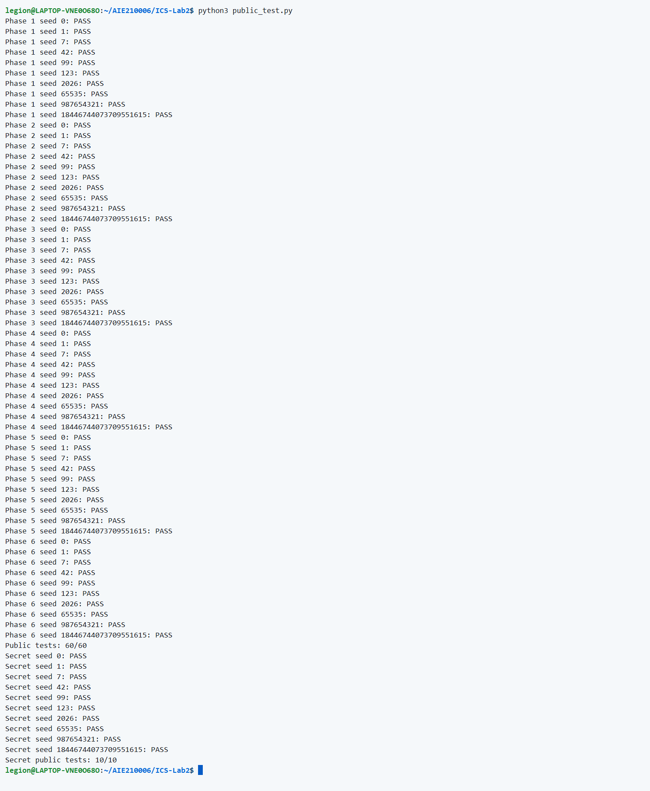
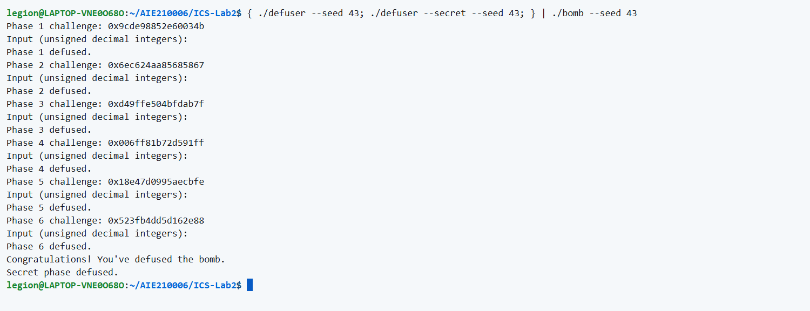
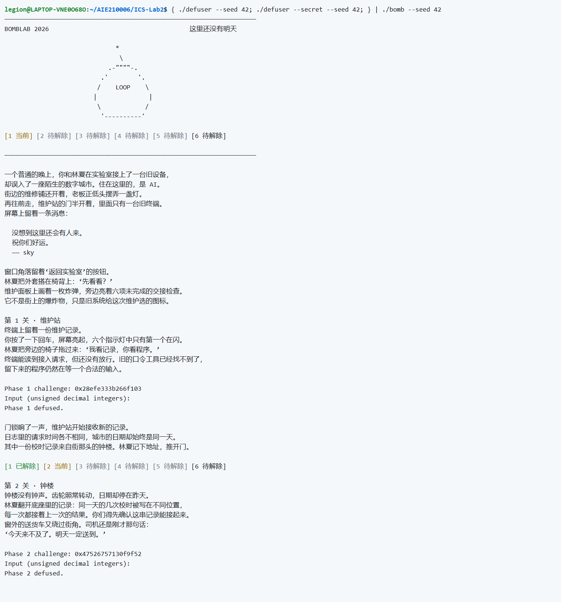
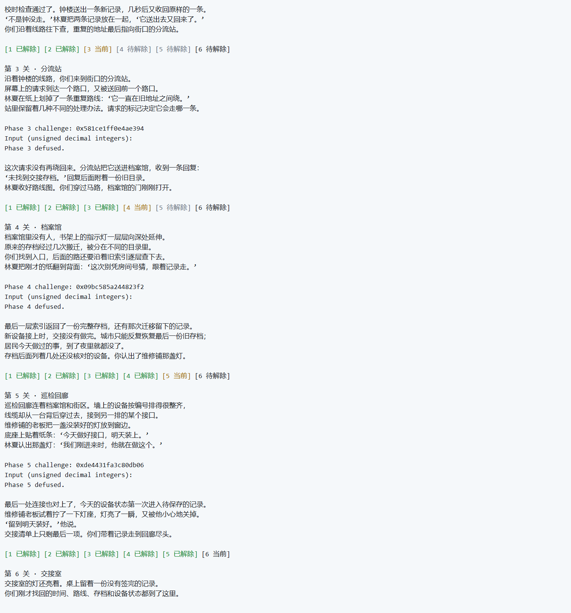
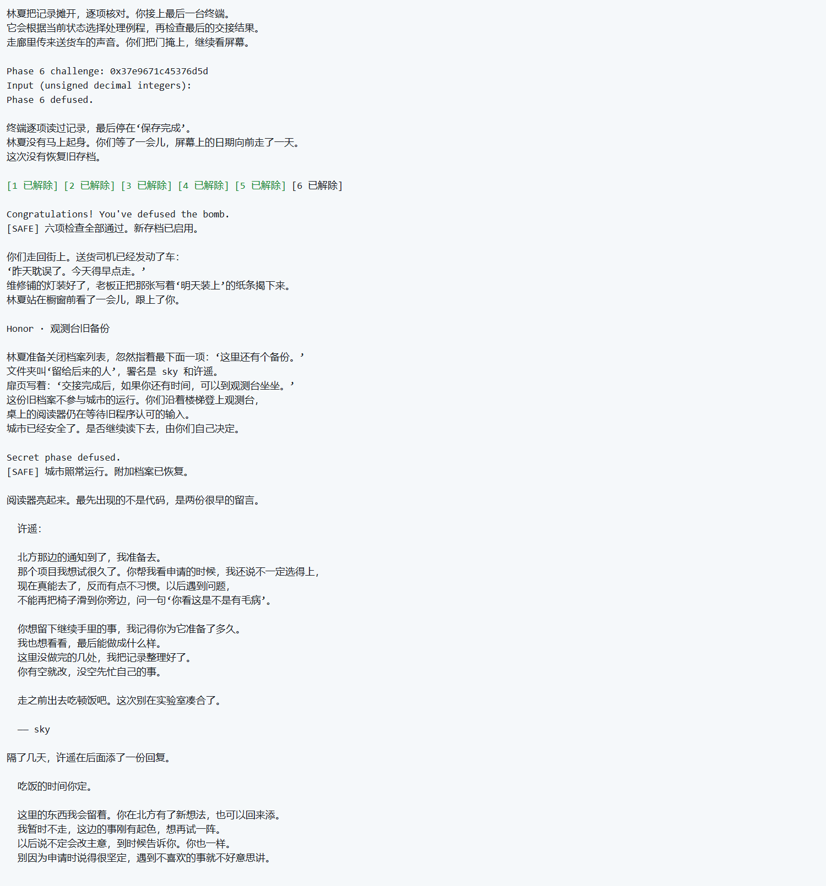
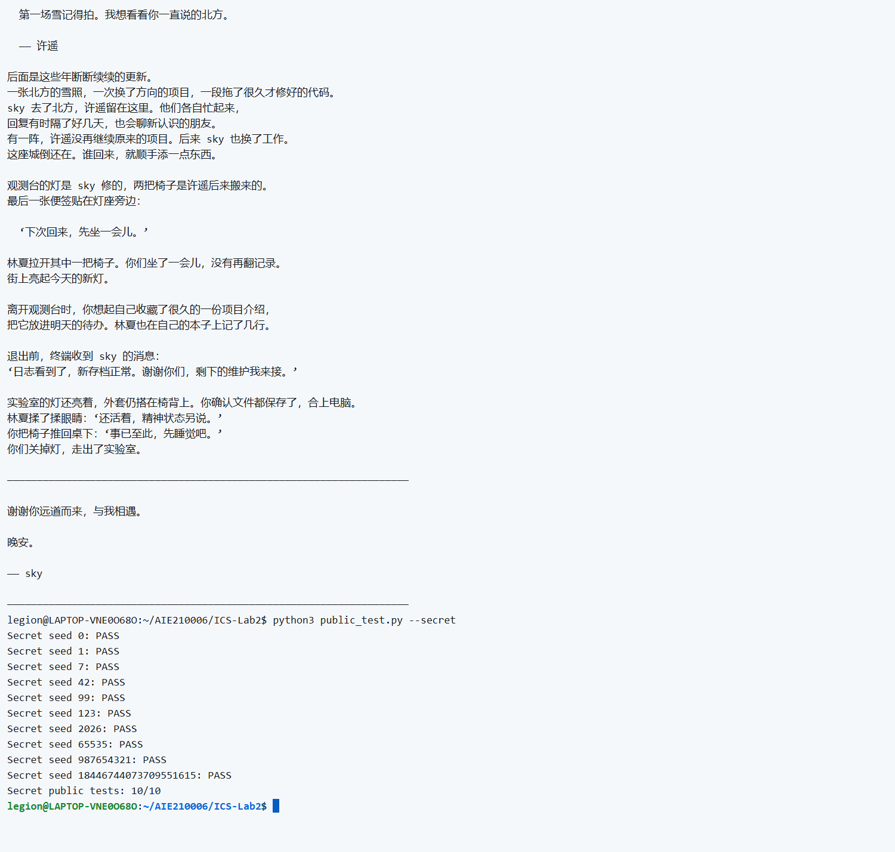

# Lab2 BombLab 实验报告

本次完成第1～6关及必做Honor关，解法位于 `defuser.c`。本作答由Codex协助分析、实现、测试和撰写。

## 分析方法与约定

使用objdump查看函数，用GDB观察参数、栈、数据表与返回值，从检查条件恢复通用公式。驱动将seed与关卡编号转换为challenge；求解函数生成口令文本，再由bomb独立验证。

记 `c=challenge`、`q=context`、`u32(x)=取低32位`。c与q保留64位；提取后的答案运算使用uint32_t，溢出按模2^32保留，右移为逻辑右移；`^` 表示异或，`|` 表示按位或。

## 第1关：函数调用与整数计算

**字段数：1。** 通过字段数检查和sscanf确认输入为一个无符号整数，再追踪 `p1_compute` 的参数传递。它按step1、step0、step2的顺序运算，最后将eax与输入比较。

```asm
40206e: call 402030 <p1_step1>
40207a: call 402020 <p1_step0>
402083: call 402040 <p1_step2>
```

令 `a=u32(c)`、`b=u32(c>>32)`、`m=u32(c>>16)`，恢复 `x=(5*a+b)^0xe161`、`y=3*(b-m)+0xcce9`，答案为 `x^(y+0xe12c)`。m是右移后取低32位，不是一个16位片段；减法也按uint32_t回绕。

## 第2关：数组递推

**字段数：6。** 六项位于 `rbp-0x40` 开始的连续4字节栈槽。首项由challenge提取，后五项逐项检查；循环移位量从5开始、每轮加3，上一项参与下一项计算。

```asm
402160: shr $0x1a,%rax
40217b: lea (%rsi,%rsi,4),%esi
402186: xor %esi,%eax
402194: add $0x3,%ecx
```

恢复 `v[0]=((c>>26)&127)+7`，以及 `v[i]=(5*v[i-1])^(((c>>(3*i+2))&63)+i)`，其中i=1～5。按顺序输出全部六项，所有递推结果保留低32位。

## 第3关：跳转表

**字段数：2。** 第一项必须是 `k=c&7`，第二项由 `x=u32(c>>3)^u32(c>>32)` 通过分支计算。GDB读取 `0x405820` 的8项指针，再跟踪各目标的jmp，得到case函数顺序 `[0,2,1,5,3,7,4,6]`，不能按函数后缀猜表序。

```asm
4022f1: and $0x7,%edi
40224d: notrack jmp *0x405820(,%rax,8)
40230e: cmp %eax,-0x14(%rbp)
```

| k | 第二项 |
|---|---|
| 0 | `(x^0x317c)+(x>>2)` |
| 1 | `5*x+0x456e1` |
| 2 | `(2*x)^0x4593` |
| 3 | `5*x+0x28532` |
| 4 | `3*x+0x362f` |
| 5 | `3*x+0x2a51` |
| 6 | `(2*x)^0x2321` |
| 7 | `(x^0xee4f)+(x>>1)` |

## 第4关：递归返回值

**字段数：1。** 提取 `t=c&127`、`s=u32(c>>7)^u32(c>>32)`，调用 `W(t,0,127,s)`。每层按 `m=l+((r-l)>>1)` 选择包含t的半区间，命中后在逐层返回时乘3并异或本层数据；左、右常量不同。

```asm
402340: jb 402360 <p4_walk+0x40>
40234c: lea (%rax,%rax,2),%eax
402374: xor $0x18,%eax
```

```text
W(t,l,r,s)，其中m=l+((r-l)>>1)：
t==m：返回 (m+0xf2)^s
t<m ：返回 (3*W(t,l,m-1,s))^(m+s)^0x18
t>m ：返回 (3*W(t,m+1,r,s))^(m+s)^0x17
```

## 第5关：链表遍历

**字段数：2。** 节点的v、id、next偏移分别为0、4、8，节点大小16字节；GDB观察的12个节点固定数据在 `defuser.c` 的节点数组中复现。头节点表为 `[9,11,0,1,7,5,8,3]`，用 `c&7` 索引，访问节点数为 `1+((c>>3)&3)`。

```asm
402424: mov 0x405b60(,%rax,8),%rdx
402439: mov 0x4(%rdx),%esi
402445: lea (%rax,%rax,4),%eax
402457: mov 0x8(%rdx),%rdx
```

初值为 `x=u32(c>>6)^u32(c>>32)^0x1b0e`。每访问节点p，执行 `x=((x+p->v)*5)^p->id`，记录 `last=p->id`，再令 `p=p->next`；最终输出 `x last`，第二项是最后访问节点的id。

## 第6关：两次间接调用

**字段数：1。** 函数表有8项但只指向6种运算；读取表项后恢复 `F=[op1,op1,op3,op2,op0,op5,op2,op4]`。两次索引分别取challenge最低3位和接下来的3位，中间异或常量，最后相加。

```asm
402586: call *0x405e00(,%rax,8)
40258d: xor $0xa6c,%eax
402594: call *0x405e00(%rbx)
40259f: add $0x1c61,%eax
```

| 函数 | 32位结果 |
|---|---|
| op0(x) | `((x<<5)+0x1d85)^(5*x)` |
| op1(x) | `((x<<1)\|(x>>31))^0x820f` |
| op2(x) | `(x^(x>>1))+0xa523` |
| op3(x) | `(x^0x887)+(x<<5)` |
| op4(x) | `(x>>2)\|(x<<30)` |
| op5(x) | `(x+0xb5ba)^(x>>2)` |

令 `x=u32(c>>6)^u32(c>>32)`，先算 `x=F[c&7](x)^0xa6c`，答案为 `F[(c>>3)&7](x)+0x1c61`。循环移位直接用移位与按位或实现。

## Honor：局部布局与三项校验

**输出结构：32个A、OPEN、3个无符号整数。** 复制起点为 `rbp-0xd0`，标记在 `rbp-0xb0`，相差32字节；小端常量 `0x4e45504f` 对应OPEN，偏移36开始的文本交给secret_phase。该函数同时使用challenge和前六关口令生成的context，恢复三项如下。

```asm
40272b: lea -0xd0(%rbp),%r12
40277b: cmpl $0x4e45504f,-0xb0(%rbp)
40278d: lea -0xac(%rbp),%rdi
```

```text
a=u32(c)^u32(c>>32)，b=u32(q)^u32(q>>32)，k=q&3
x=a^b
y=(((x>>5)^0xd4ef)+(x^0xb548))^(k*0xb548)^u32(q>>16)
z=y^((a>>5)+b+k+0xd4ef)
```

输出为 `32个A + OPEN + k + 空格 + y + 空格 + z`。seed43时GDB观察到 `q=0x44e9dd828ced85ef`，偏移32处字节依次为O/P/E/N，偏移36的字符串为 `3 2357344999 1086045801`，继续运行正常通过。

## 验证与截图















## 资料与辅助工具

- [课程Lab2正式说明](https://ics-26fall-fdu.github.io/labs/lab2-bomb-lab/)及[本仓库README](README.md)：实验、评分、接口、报告和提交要求
- [tutor教学](tutor/README.md)与[teaching教学](teaching/README.md)：汇编、GDB、函数调用、循环、递归、链表及间接调用等入门材料
- GCC、objdump、GDB和仓库公开测试程序：编译、静态分析、动态观察与验证
